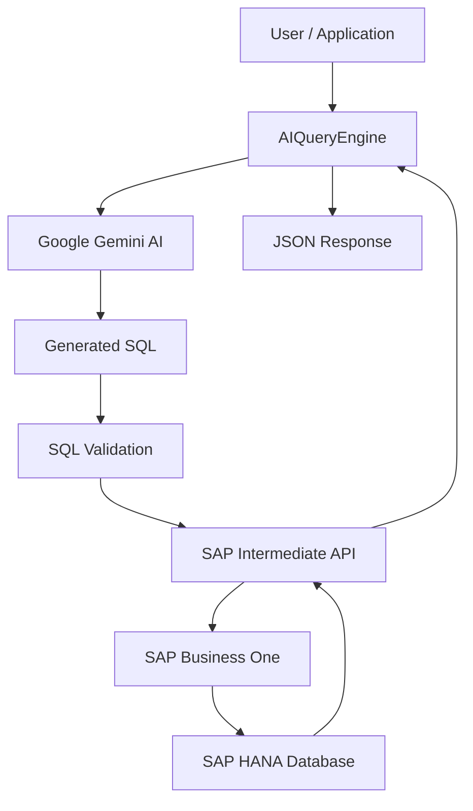

# AIQueryEngine

### AI-powered Natural Language to SQL for SAP Business One

<p align="center">
  
  
  
  
  
  
  
  
  
  
</p>

## Overview

**AIQueryEngine** is a .NET Minimal API designed to transform natural language questions into SQL queries for SAP Business One running on SAP HANA.

Powered by Google Gemini AI, the application interprets user questions, generates SQL statements, validates them against an available SAP table catalog, and forwards approved queries to an intermediate SAP API for execution.

The goal is to simplify access to ERP data by allowing users and applications to interact with SAP Business One using natural language instead of writing SQL manually.

## Key Features

- **Natural Language Processing:** Convert everyday questions into SQL queries using Google Gemini.
- **SAP Business One Integration:** Designed for SAP Business One 9.3 with SAP HANA.
- **AI-Powered SQL Generation:** Automatically generates SQL SELECT statements based on the user's request.
- **SQL Validation:** Checks generated queries before execution, including allowed tables, SQL commands and query limits.
- **SAP Table Catalog:** Uses an external catalog containing SAP Business One table information to guide SQL generation and validation.
- **Intermediate API Integration:** Delegates SQL execution to a separate SAP API.
- **Structured Responses:** Returns generated SQL, execution metadata and raw SAP response data.
- **API Documentation:** OpenAPI documentation with Scalar interface.
- **Dependency Injection:** Uses ASP.NET Core dependency injection for client and service management.

## Architecture

The application follows a simple integration architecture:



### Main Components

| Component | Responsibility |
|---|---|
| SalesEndpoints | Exposes the REST API endpoints using Minimal API. |
| GeminiClient | Communicates with Google Gemini to generate SQL queries. |
| SapApiClient | Sends validated SQL queries to the intermediate SAP API. |
| SapTableCatalog | Loads and provides the SAP table catalog. |
| ChatRequest | Defines the incoming request model. |

## Technologies

- C# / .NET 11
- ASP.NET Core Minimal API
- Google Gemini API
- SAP Business One 9.3
- SAP HANA
- REST APIs
- HTTP Client
- System.Text.Json
- OpenAPI
- Scalar

## Getting Started

### Prerequisites

Before running the project, make sure you have:

- .NET 11 SDK
- A Google Gemini API key
- Access to the intermediate SAP API
- SAP Business One 9.3 with SAP HANA
- The SAP table catalog file configured for the application

### Configuration

Configure the application settings in `appsettings.json`:

```json
{
  "Gemini": {
    "ApiKeyFile": "/etc/servermcp/gemini-api-key.txt"
  }
}
```

The Gemini API key must be stored in an external text file on the server.

Example:

```text
YOUR_GEMINI_API_KEY
```

Do not commit API keys or other sensitive credentials to the repository.

The SAP intermediate API and table catalog must also be configured according to their respective implementations.

### Running the Application

Clone the repository:

```bash
git clone https://github.com/YOUR_USERNAME/AIQueryEngine.git
```

Navigate to the project directory:

```bash
cd AIQueryEngine
```

Restore dependencies:

```bash
dotnet restore
```

Run the application:

```bash
dotnet run
```

## API Usage

### Generate SQL from Natural Language

**Endpoint:**

```http
POST /api/v1/sales
```

**Request Body:**

```json
{
  "message": "Show me the last 10 sales orders"
}
```

**Example Response:**

```json
{
  "sql": "SELECT T0.\"DocNum\", T0.\"CardCode\", T0.\"CardName\" FROM ORDR T0 ORDER BY T0.\"DocDate\" DESC LIMIT 10",
  "tamanhoResposta": 850,
  "quantidadeRegistros": 10,
  "erroJson": null,
  "dadosBrutos": []
}
```

*Note: The response above is illustrative. Actual results depend on the generated SQL and the SAP API response.*

## SQL Validation

Before executing a generated query, AIQueryEngine performs several validation checks:

- Only SELECT statements are allowed.
- Multiple SQL statements are rejected.
- SQL comments are rejected.
- UNION and WITH/CTE statements are rejected.
- Write and administrative commands are blocked.
- Referenced tables must exist in the configured SAP table catalog.
- Qualified columns must use double quotes.
- LIMIT must be between 1 and 100.

These checks provide an additional validation layer before queries are forwarded to the SAP API.

## API Documentation

The project uses OpenAPI and Scalar to provide interactive API documentation.

After starting the application, access the Scalar interface through the configured documentation route.

## Project Goals

AIQueryEngine aims to explore how Generative AI can simplify ERP data access and create more intuitive ways to interact with business systems.

Future possibilities include:

- Additional AI providers.
- More SAP Business One query scenarios.
- Improved SQL validation and query safety.
- Structured and customizable result formatting.
- Support for additional endpoints and business domains.
- Integration with conversational interfaces and automation platforms.

## Disclaimer

This project is an independent integration solution and is not an official SAP product.

AI-generated SQL must always be validated before execution. The current validation mechanism uses rule-based checks and regular expressions and should not be considered a complete SQL security solution.

## License

Specify your preferred open-source license here.

---

**Built with C#, .NET, Google Gemini and SAP Business One.**
